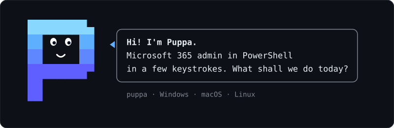

# Puppa

**English** · [Svenska](README.sv.md)

<p align="center">
  
</p>

Common Microsoft 365 admin tasks in PowerShell in a few keystrokes, instead of typing cmdlets.
Works the same on **Windows, macOS and Linux**. One of the tools in the troupe with [Uppa](https://github.com/pipebreak33/uppa),
[Muppa](https://github.com/pipebreak33/muppa), [Euppa](https://github.com/pipebreak33/euppa), [Ruppa](https://github.com/pipebreak33/ruppa)
and [Wuppa](https://github.com/pipebreak33/wuppa). The mascot is a P with eyes: it suggests the next step, blinks and
looks around while something runs, is happy when it went well and sad on errors.

## Install (or update: run the same line again)

**Windows** (PowerShell):

```powershell
irm https://raw.githubusercontent.com/pipebreak33/puppa/main/install.ps1 | iex
```

**macOS / Linux:**

```bash
curl -fsSL https://raw.githubusercontent.com/pipebreak33/puppa/main/install.sh | sh
```

The installer finds (or on Windows installs) Python 3.8+, puts Puppa in `~/.puppa/app` and creates the command
`puppa` (`~/.local/bin/puppa`, or `%USERPROFILE%\.puppa\bin\puppa.cmd` + PATH on Windows). Your tenants and
own recipes in `~/.puppa` are never touched by an update. It warns if PowerShell 7 or the modules are missing.
With [Uppa](https://github.com/pipebreak33/uppa), Puppa can also be installed and updated from there.

Choose the source with `PUPPA_REPO=owner/repo` and `PUPPA_BRANCH=branch`. From a local copy: `./install.sh` / `./install.ps1`.

Needs PowerShell 7 (`pwsh`) and the modules you want to use: PnP.PowerShell 3.x, ExchangeOnlineManagement,
MicrosoftTeams, Microsoft.Graph, ImportExcel, Microsoft.PowerShell.SecretManagement + SecretStore.

## Uninstall

**Windows** (PowerShell):

```powershell
irm https://raw.githubusercontent.com/pipebreak33/puppa/main/uninstall.ps1 | iex
```

**macOS / Linux:**

```bash
curl -fsSL https://raw.githubusercontent.com/pipebreak33/puppa/main/uninstall.sh | sh
```

Removes the program and the `puppa` command (and the PATH entry on Windows). Your tenants, settings, certificates and own recipes in `~/.puppa`, and the reports in `~/Documents/Puppa`, are kept.
`PUPPA_PURGE=1` removes your data too, and `PUPPA_YES=1` skips the question.

## How it works

- **No preparation.** Pick a recipe. Puppa signs in when needed (Exchange, Graph, Teams) and adds the
  tenant to the **Tenants** list with domain and account, so you can switch between customers later.
- **Carry on where you left off.** The start screen shows the tenant you worked in and your recent recipes at the top.
- **Search everywhere.** Start typing in any menu and it filters fuzzily. In the main menu you search all
  recipes directly (`shared`, `mailb`, `block` …).
- **Search the tenant.** When a recipe asks for a user, group, mailbox, distribution list, site or team,
  part of the name is enough: `john` gives a list to choose from, and a single match is picked directly.
- **Licenses from a list.** Recipes that ask for a license show the tenant's own licenses with readable names and
  "used of total". Tick one, several or **All licenses** (ctrl+a ticks everything shown), so *Who has a given license?*
  lists everyone with any license in one go, with a License column, ready for Excel.
- **SharePoint = PnP.** Only the SharePoint recipes go through PnP PowerShell, which needs its own Entra ID app per tenant.
  The first time, Puppa offers a **new PnP app registration** (`Register-PnPEntraIDAppForInteractiveLogin` /
  `Register-PnPEntraIDApp`), or **finds an existing PnP app** in the tenant via Graph
  (PnP in the name, or a public client with SharePoint permissions), or you paste a ClientId. Nothing is created in the tenant until you answer **y**.
- **You always see the command** that runs. **read** recipes run directly.
- **Always a dry run first.** Recipes marked **changes** are first run as a dry run: with `-WhatIf` where the cmdlets
  support it (Graph, Exchange), and for the ones that don't (PnP, Teams) Puppa shows each command with its values
  instead of running it. Then it asks **Run it for real?** Puppa signs in first, so you see which tenant the change
  lands in. `puppa run RECIPE --whatif` does only the dry run.
- **An Excel report of everything.** After every read recipe, choose **Export to Excel** (`x`) or **CSV** (`c`).
  The report (`~/Documents/Puppa/tenant-recipe-date.xlsx`) has a summary with the recipe's name, tenant,
  your choices, the number of rows and the period, breakdowns per repeating column (per person, type, site,
  event …) with count and share, one sheet per day when there are times, and the result as a filterable table
  with a frozen header row, date format and clickable links. Without the menu: `puppa run RECIPE … --excel` (or `--csv`).
- **No keychain prompt.** On macOS, Puppa by default does not keep the sign-ins in the keychain (Graph
  `-ContextScope Process`, PnP without `-PersistLogin`), so an unsigned Homebrew `pwsh` doesn't ask every time.
  You sign in once per run. Turn on **Remember sign-ins** under *Sign in…* if you want to keep them.
- **Sign out…** of everything (the default) or one service at a time. Also clears saved sign-ins
  (PnP `-ClearPersistedLogin`, Graph token). Puppa asks when you quit too.

## Language

Puppa speaks **English** by default and **Swedish** on request, the menus as well as the recipes' output. The choice
is shared by the whole troupe: `puppa lang sv` or `puppa lang en`, or the **Language** row in the menu.
`TRUPPA_LANG=sv` sets it for a single run. Swedish commands (`puppa kör`, `--ja` …) still work.

## Users

**Users…** in the menu (or `puppa users`) lists every user in the tenant you are signed in to. Type to
fuzzy-search on name, email, title or department (`ann`, `fin` and `asm` all find Anna Smith in Finance).
Space or tab ticks, ctrl+a ticks everyone shown, enter is done. Then you see what you can do with the chosen ones:
every recipe that takes a user, for example adding to a group or team, blocking sign-in, showing MFA methods,
sign-ins, devices and group memberships. Recipes that take several users run once for all. The others run once
per person: the fields are asked once and a change is confirmed once. New recipes with `@user` show up here by themselves.

## Commands

| | |
|---|---|
| `puppa` | the menu |
| `puppa tenants` · `puppa tenant NAME` | list / switch tenant |
| `puppa new` | add a tenant by hand (rarely needed) |
| `puppa pnp [TENANT]` | new PnP app registration (or enter a ClientId) |
| `puppa test [TENANT]` · `puppa shell [TENANT]` | test PnP / a pwsh shell that has already run `Connect-PnPOnline` |
| `puppa recipes` | list every recipe |
| `puppa users [UPN …]` | pick users (fuzzy search, multi-select) and do something with them |
| `puppa lookup TYPE [SEARCH] [--all] [--json]` | search the tenant: `user`, `group`, `mailbox`, `site`, `team`, `sku` … (`--all` = every user, `--json` for other programs, e.g. Ruppa and Muppa) |
| `puppa run RECIPE Name=value … [--yes] [--whatif] [--excel\|--csv]` | run a recipe without the menu, optionally straight to Excel/CSV |
| `puppa logout` | sign out of everything |
| `puppa lang [en\|sv]` | language for the whole troupe |
| `-n` / `--dry-run` | show the commands, run nothing |
| `--no-anim` | no animations (also off with `NO_COLOR` and when the output is piped) |

## Recipes (78)

SharePoint (sites, largest sites, site info, permissions, users, lists, recycle bin/restore,
external sharing, site admins, SharePoint groups, deleted sites, tenant settings, **what has been moved** –
who (UPN), when, from/to as links + suggestions where to look; **who deleted things** – with an Excel report) ·
OneDrive (find, largest, give access) · Exchange (mailboxes, shared mailboxes: create, give/remove access,
who has access, what a user can reach; convert to shared, forwarding, auto-reply,
calendar permissions, rooms, distribution lists, message trace) · Groups (list, members,
a user's groups, add/remove, without owners) · Users (info, licenses, **who has which license**,
inactive, guests, invite a guest, block sign-in, MFA methods, admin roles) · Teams (teams, members,
add, channels, teams with one owner) · **Entra ID** (about the tenant, sign-ins per user, failed
sign-ins, who changed what, Conditional Access, devices, a user's devices, enterprise apps and consents,
deleted users/groups, admin roles, app registrations, **find the PnP app**, expiring secrets/certificates) ·
Excel/CSV export · Local (module versions, current session).

### Your own recipe

Choose **New recipe (template)…** or put a `.ps1` in `~/.puppa/recipes/` (it wins over built-in ones with the same name):

```powershell
<#PUPPA
namn:        Members of a team
name_en:     Members of a team         # optional English name (namn is shown in Swedish)
kategori:    Teams
typ:         läs                 # läs (read) | ändrar (changes) | lokal (local)
kräver:      teams               # ingen | pnp-admin | pnp:Url | exo | teams | graph:Scope1,Scope2
beskrivning: Owners, members and guests in a team.
param:       Team | The team's name | | @team               # @… = search the tenant
param:       Roll | Role | Member | Member,Owner           # name | question | default | choices
param:       Filter? | Part of the name |                  # ? = optional
#>
$t = Get-Team -DisplayName $Team
Get-TeamUser -GroupId $t.GroupId | Where-Object { $_.Role -eq $Roll } | Select-Object Name, User, Role
```

Lookups: `@user` `@group` `@sku` (Graph) · `@mailbox` `@recipient` `@dl` (Exchange) · `@site` `@spuser` (PnP) ·
`@team` (Teams) · `@app` (app registrations, the value becomes the ClientId). Add `+` for several values (`@user+` becomes `a@x.com,b@x.com`).
The parameters become variables (`$Team`). In defaults and scripts, `{tenant}` `{prefix}`
`{adminUrl}` `{rootUrl}` `{upn}` `{kund}` `{datum}` work. Return objects and the result can be exported.
In your messages, `T 'English' 'Svenska'` picks the chosen language.

## Security

- `~/.puppa/kunder.json` contains no secrets (name, domain, tenant id, account, ClientId, sign-in method).
- Certificate passwords (app-only PnP) live in PowerShell's **SecretManagement**, in the vault `Puppa` (SecretStore),
  on every platform. If there is no vault, Puppa asks whether to lock it with its own password or just with your
  user account. The password reaches PowerShell through an environment variable that is removed right after connecting,
  never on the command line. The `.pfx` file is password-protected in `~/.puppa/certs/`.

## Technology

One Python file (standard library only, 3.8+) plus the recipes as `.ps1`. Long-lived `pwsh` processes run the recipes,
so the sign-ins live between runs. PnP runs in its own process, because PnP.PowerShell and
ExchangeOnlineManagement load different versions of MSAL and crash in the same process ("Method not found … WithBroker").
Keys are read with `msvcrt` on Windows and `termios` on macOS/Linux.
The layout scales with the terminal: no lines wrap, a narrow layout below 58 columns, the mascot hides below 44, and everything
is redrawn when the window changes size (on Windows too, where SIGWINCH is missing).
